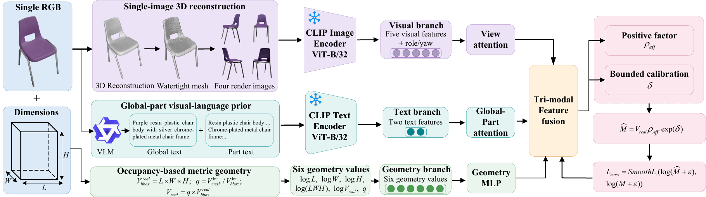

# GeoVLMass

**Geometry-aware Vision-Language Mass Estimation** from a single image.

This is an inference-only release of the seed-0 GeoVLMass estimator. It
contains the validation-selected checkpoint and the **1,435-sample Amazon test
split** in a compact, ready-to-evaluate form. The four example objects are
included in this directory.

`GeoVLMass` is the name of this code release. The accompanying manuscript uses
the descriptive title *Object Mass Estimation via Single-Image 3D Reconstruction
and Global--Part Vision--Language Priors*.

## Quick Start

```bash
cd GeoVLMass
python -m pip install -r requirements.txt
python demo.py
```

The same demo can be launched from any working directory:

```bash
./run_demo.sh
```

Optional integrity check:

```bash
python verify_release.py
```

The demo prints predicted mass, recorded mass, absolute error, and relative
error, all masses in kilograms. It runs on CPU by default if CUDA is unavailable.
It performs **new model inference** from the included features; it does not read
predictions from a CSV. Default results are:

```text
sample_id            predicted_kg    actual_kg    abs_error_kg    relative_error
amazon_test_6771           0.6823       0.6804          0.0020            0.29%
amazon_test_6698           0.2256       0.2268          0.0012            0.53%
amazon_test_6829           2.7947       2.8123          0.0176            0.63%
amazon_test_7521           0.3470       0.3493          0.0023            0.66%
```

Select any test IDs or evaluate the full split:

```bash
python demo.py --samples amazon_test_6771 amazon_test_7521
python demo.py --all --output-csv results/amazon_1435_predictions.csv
```

| Example | Gallery |
| --- | --- |
| Vegetable slicer, `amazon_test_6771` | [original + four renders](examples/amazon_test_6771/contact_sheet.png) |
| Electronic thermometer, `amazon_test_6698` | [original + four renders](examples/amazon_test_6698/contact_sheet.png) |
| Metal toaster, `amazon_test_6829` | [original + four renders](examples/amazon_test_6829/contact_sheet.png) |
| Ceramic mug, `amazon_test_7521` | [original + four renders](examples/amazon_test_7521/contact_sheet.png) |

These are **selected low-error examples**, not a representative estimate of
test-set accuracy. Use `--all` for the full test result. The original seed-0
run reported ALDE 0.4161 and Q 0.8251 on all 1,435 samples. Its reference
metrics are in `data/seed0_reference_metrics.json`.

## Pipeline

See [the manuscript pipeline PDF](assets/Figure1.pdf).



One RGB image and measured
length, width, and height are processed upstream into a watertight mesh, four
selected rendered views, object and component descriptions, and an occupancy
ratio. The five images and two global/part-level descriptions are encoded with
`openai/clip-vit-base-patch32` into frozen 512-dimensional features. The mass
regressor combines five visual features with their view roles and yaw angles,
two text features, and six geometry values. Its output is
`M = V_real * rho_eff * exp(delta)`, where `V_real = L * W * H * occupancy`.
`rho_eff` is a learned effective coefficient, not a directly measured material
density.

## Pre-trained Model

The included `checkpoints/seed0_best.pt` is the seed-0 model selected by the
lowest validation ALDE. It is ready for inference and does not require a model
download. The package includes the frozen CLIP features used by the release;
the upstream CLIP weights are not needed for the included demo.

This lightweight package begins **after** 3D reconstruction, description
generation, view selection, and CLIP encoding. It supports reproducible
evaluation of the supplied test split; it does not accept an arbitrary new
image without those upstream inputs. The bundled 1,435-sample test set is
`data/amazon_1435_features.npz` (features and targets) plus
`data/test_manifest.jsonl` (descriptions, dimensions, occupancy, yaw, targets).
Raw images and meshes for the whole split are not bundled. Four selected cases
include their original images, rendered views, and contact sheets.

All files required by `demo.py` are inside this directory. The demo does not
read the original training project, external datasets, or any absolute path.

### Reproducibility Scope

Cloning or downloading this directory is sufficient to reproduce the packaged
seed-0 inference results and the full 1,435-sample test metrics. The package
starts after the upstream 3D reconstruction, view selection, description
generation, and CLIP feature extraction stages. It does not claim to reproduce
those upstream stages or train a new model from scratch; the required frozen
features, targets, metadata, checkpoint, and example images are already
included here.

## Package Contents

```text
GeoVLMass/
  demo.py                         # CPU/CUDA inference and evaluation
  run_demo.sh                     # location-independent demo launcher
  model.py                        # inference-only regression network
  verify_release.py               # package integrity check
  checkpoints/seed0_best.pt       # seed 0, validation-selected epoch 69
  data/amazon_1435_features.npz   # 1435 frozen CLIP feature sets and targets
  data/test_manifest.jsonl        # compact test metadata without local paths
  data/seed0_reference_metrics.json
  examples/                      # four selected visual cases
  assets/Figure1.pdf
  assets/Figure1.png
  requirements.txt
  LICENSE
```

The bundled checkpoint is the seed-0 model selected at epoch 69 by the lowest
validation absolute log error. Training code and train/validation records are
not required for inference.

## License and Citation

The release code is under [Apache License 2.0](LICENSE), following the
reference release format. The checkpoint, test metadata, CLIP features, and
example imagery have separate provenance; verify their redistribution terms
before publishing this directory externally. The upstream CLIP model weights
are not included.

If this implementation supports your work, cite the accompanying manuscript:

```text
Object Mass Estimation via Single-Image 3D Reconstruction and
Global--Part Vision--Language Priors
```
